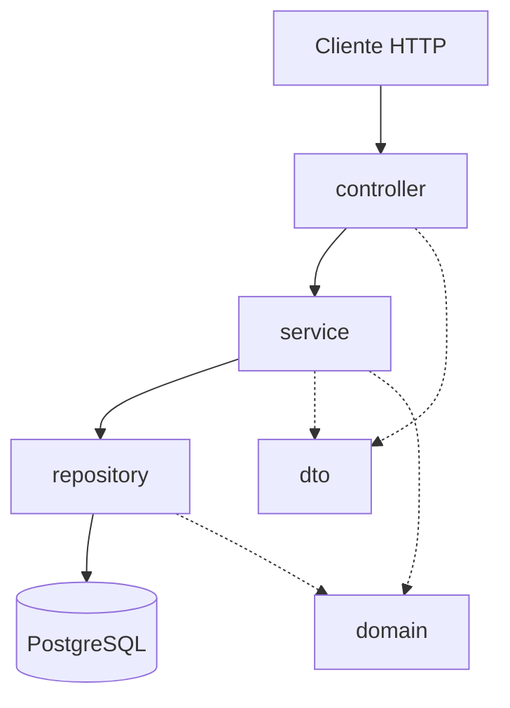

# Arquitectura

API REST en Java 21 y Spring Boot para administrar un registro de personas. Guarda los datos en PostgreSQL y las tablas se crean con migraciones de Flyway.

## Capas

El proyecto está dividido en capas, y las dependencias van siempre hacia abajo: el controlador usa el servicio y el servicio usa el repositorio.

Las flechas con línea punteada son "usa". `domain` no depende de ningún otro paquete.

## Más información

- Reglas de cada paquete (qué va y qué no va): [components/backend/index.md](../components/backend/index.md)
- Tabla de la base de datos: [modelo-de-datos.md](modelo-de-datos.md)
- Decisiones del proyecto: [decisiones.md](decisiones.md)
