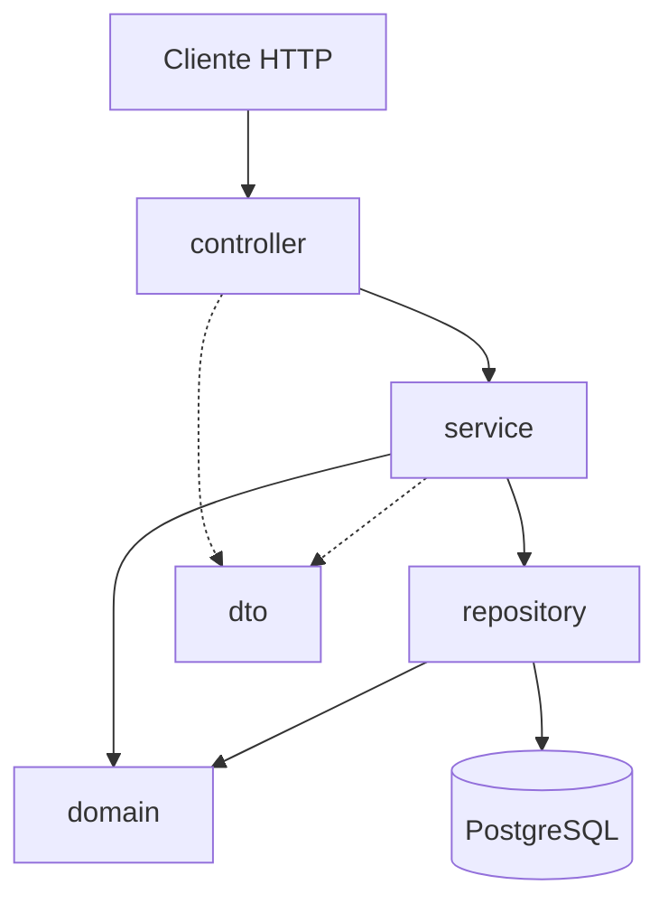

# Arquitectura

API REST en Java 21 y Spring Boot para administrar un registro de personas. Guarda los datos en PostgreSQL y las tablas se crean con migraciones de Flyway.

## Capas

Las dependencias van hacia adentro: `domain` es la capa interna y no depende de ninguna otra. El `repository` solo usa el `domain` y nunca llama al `service`.

**Leyenda.**la flecha continua (->) significa que una capa llama o depende de otra. La flecha punteada (-.->) significa que la capa usa los dto para recibir o devolver datos. 

## Más información

- Reglas de cada paquete: [components/backend/index.md](../components/backend/index.md)
- Tabla de la base de datos: [modelo-de-datos.md](modelo-de-datos.md)
- Decisiones del proyecto: [decisiones.md](decisiones.md)
